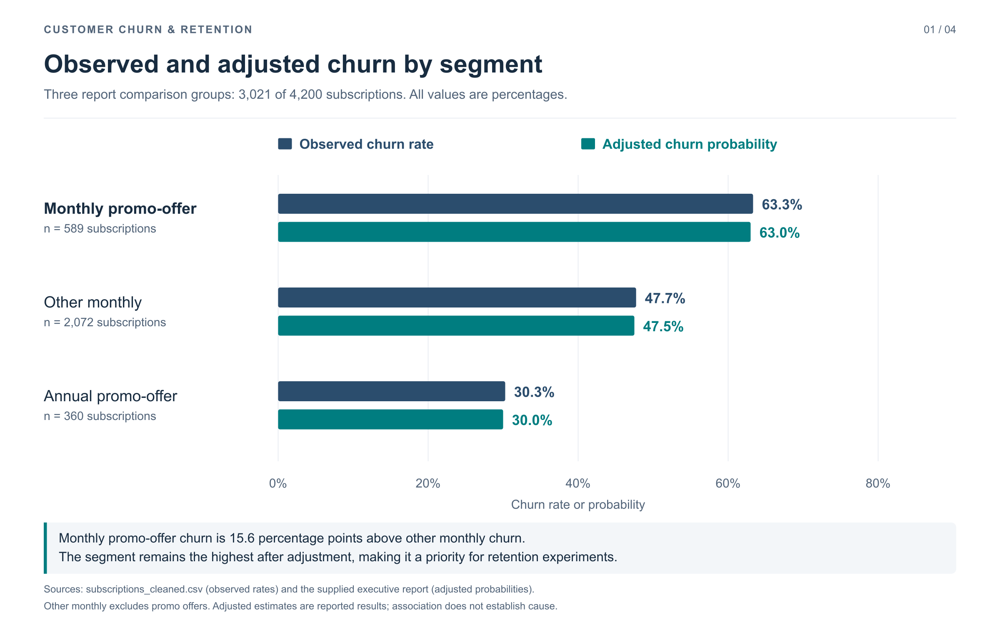
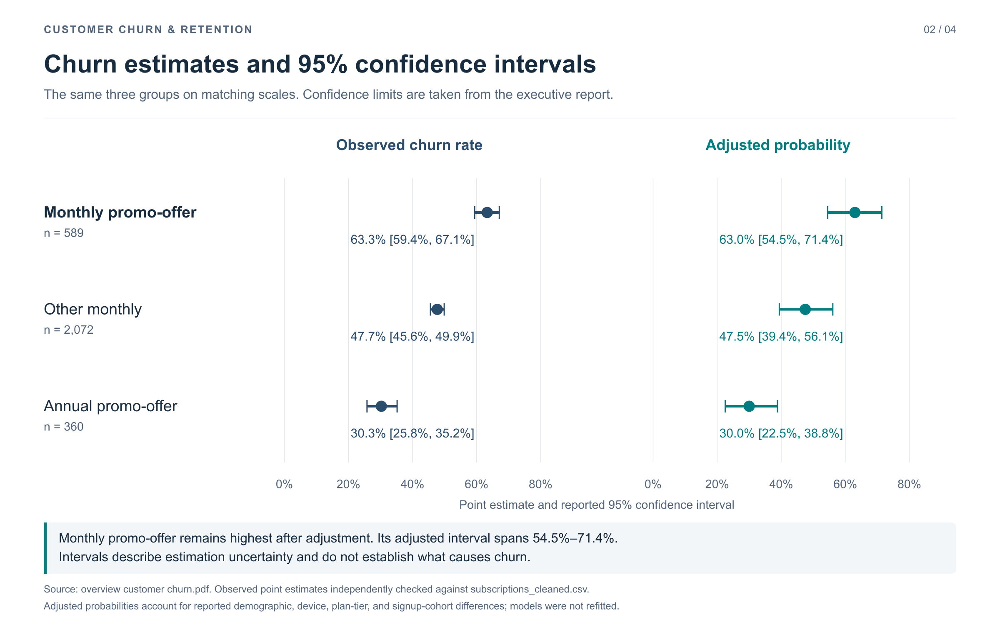
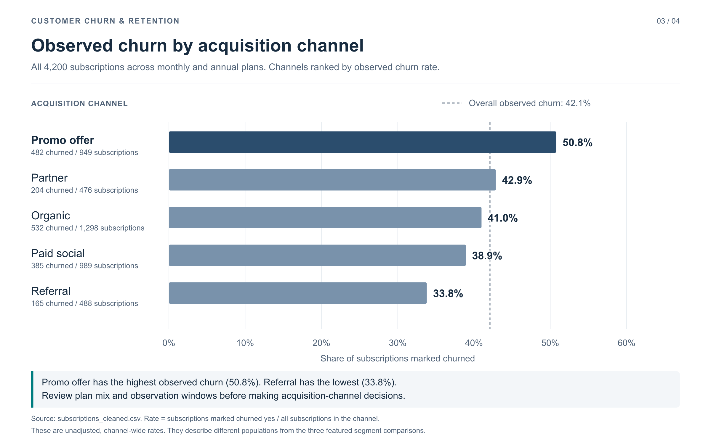
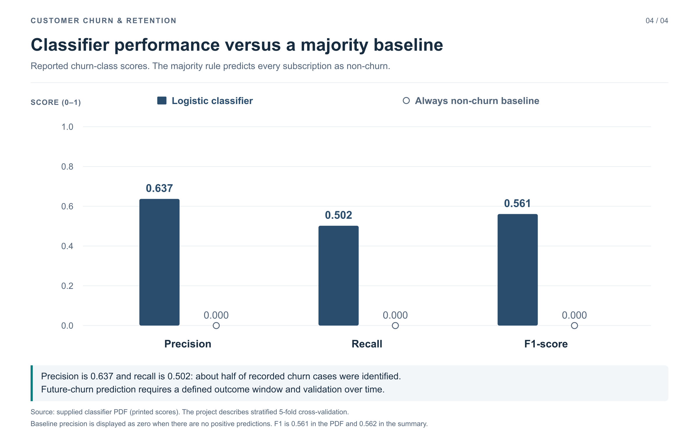

Customer Churn Analysis & Retention Strategy

**Analyzing 4,200 fitness subscriptions to identify retention priorities and recommend experiments.**

Monthly subscribers acquired through promotional offers had the highest observed churn among the three segments compared in the report: **63.3%**, versus **47.7%** for other monthly subscribers. This project uses customer segmentation, statistical comparisons, and logistic regression to turn that finding into practical retention recommendations.

 **[Explore the cleaned dataset](subscriptions_cleaned.csv)** | **[View the segment comparison](churn_observed_vs_adjusted_segments.png)** | **[View classifier results](churn_classifier_performance.png)**

## Business Problem

Customer churn reduces recurring revenue and increases the cost of replacing lost subscribers. For a subscription-based fitness service, the key business question is:

> Which subscriber groups should the business prioritize for retention efforts, and what should it test to improve retention?

The analysis uses **subscriptions_cleaned.csv**, supported by the executive report and supplied classification results. Each row represents one subscription. The featured comparison focuses on monthly promo-offer subscribers, other monthly subscribers, and annual promo-offer subscribers.

## Results at a Glance

| Metric | Result |
| --- | ---: |
| Total subscriptions analyzed | 4,200 |
| Churned subscriptions | 1,768 |
| Non-churned subscriptions | 2,432 |
| Overall observed churn rate | 42.1% |
| Subscriptions in the three featured segments | 3,021 |

Observed churn is **the number of subscriptions marked churned divided by the number of subscriptions in the relevant group**. The three featured groups do not represent all 4,200 subscriptions. The remaining **1,179** are annual subscribers acquired through non-promo channels.

### Churn by Subscriber Segment

| Segment | Subscriptions | Observed churn rate | Adjusted churn probability |
| --- | ---: | ---: | ---: |
| **Monthly promo-offer** | 589 | 63.3% | 63.0% |
| Other monthly | 2,072 | 47.7% | 47.5% |
| Annual promo-offer | 360 | 30.3% | 30.0% |

“Other monthly” includes monthly subscribers acquired through channels other than promo offers. Adjusted probabilities account for the demographic, device, plan-tier, and signup-cohort differences reported in the executive report.

### Churn by Acquisition Channel

| Acquisition channel | Subscriptions | Churned subscriptions | Observed churn rate |
| --- | ---: | ---: | ---: |
| Promo offer | 949 | 482 | 50.8% |
| Partner | 476 | 204 | 42.9% |
| Organic | 1,298 | 532 | 41.0% |
| Paid social | 989 | 385 | 38.9% |
| Referral | 488 | 165 | 33.8% |

Channel rates cover both monthly and annual subscriptions. They describe different populations from the three featured segment comparisons.

**Business takeaway:** Monthly promo-offer churn was **15.6 percentage points higher** than other monthly churn and **33.0 percentage points higher** than annual promo-offer churn. The same ordering remained after adjustment, making this group a priority for retention testing. These associations do not prove that promotions or monthly billing cause churn.

## Visualizations

### 1. Observed Versus Adjusted Churn by Segment

[View the full-size visualization](churn_observed_vs_adjusted_segments.png)

**Interpretation:** Monthly promo-offer subscribers have **63.3%** observed churn and **63.0%** reported adjusted churn probability. The paired bars show that the three groups retain the same ordering after adjustment.

### 2. Segment Estimates and Confidence Intervals

[View the full-size confidence interval comparison](churn_segment_confidence_intervals.png)

**Interpretation:** The monthly promo-offer adjusted estimate has a reported **95% confidence interval of 54.5%–71.4%**. The matching scales show uncertainty around all three groups. Confidence intervals are reproduced from the report; the models were not refitted.

### 3. Observed Churn by Acquisition Channel

[View the full-size acquisition channel visualization](churn_observed_by_acquisition_channel.png)

**Interpretation:** Promo offer has the highest observed channel rate (**50.8%**) and referral has the lowest (**33.8%**). Review plan mix and the time available to churn before making channel decisions. This chart uses verified raw rates and does not reproduce the earlier export's unlabeled adjusted series.

### 4. Classifier Performance Versus a Majority Baseline

[View the full-size classifier evaluation](churn_classifier_performance.png)

**Interpretation:** Precision is **0.637**, recall is **0.502**, and F1 is approximately **0.56**. About half of recorded churn cases were identified. The majority baseline predicts no churn cases; the supplied display convention assigns it zero churn-class precision, recall, and F1.

All four charts are **2,400 × 1,500-pixel PNGs**, with readable labels, source notes, and business interpretations. Keep them beside this README for the relative image links to work.

## Approach & Tools

**Analysis platform:** PlotStudio AI. **Data checks and chart preparation:** Python, Pandas, and NumPy.

1. **Prepare the data:** Review subscription records, identifiers, missing values, and the recorded churn indicator.
2. **Explore churn patterns:** Compare observed churn across subscription segments and acquisition channels.
3. **Assess segment differences:** Present the executive report's adjusted logistic regression estimates and confidence intervals.
4. **Evaluate classification:** Review the reported classifier results from stratified 5-fold cross-validation against the majority-rule baseline.
5. **Recommend business tests:** Translate the findings into targeted retention experiments.

The original analysis excluded **churn_date** and **cancel_reason** from predictors to avoid using information that reveals the churn outcome. Observed rates in the new charts were recalculated from the cleaned dataset. Adjusted results and model scores are retained as supplied.

### Reported Model Evaluation

| Reported metric | Score | What it measures |
| --- | ---: | --- |
| ROC-AUC | 0.751 | Ability to distinguish churned from non-churned subscriptions across thresholds |
| Precision | 0.637 | Share of subscriptions flagged as churned that actually churned |
| Recall | 0.502 | Share of churned subscriptions correctly identified |
| F1-score | Approximately 0.56 | Balance between precision and recall |

The classifier PDF labels F1 as **0.561**, while the project summary reports **0.562**. The new visualization uses the PDF's printed score. ROC-AUC is reported in the project summary and is not plotted in the classifier chart.

These results describe classification of recorded churn in this dataset. **Future-churn prediction has not been validated.**

## Data Validation

| Validation check | Result | What it establishes |
| --- | ---: | --- |
| Subscription records | 4,200 | Dataset size agrees with the executive report |
| Unique customer identifiers | 4,200 | No duplicate customer IDs |
| Missing core identifiers, predictors, and churn flag | 0 | The nine checked fields are populated |
| Recorded churn | 1,768 yes; 2,432 no | Overall observed churn is 42.1% |
| Featured segment sizes | 589; 2,072; 360 | Counts agree with the report's comparison groups |
| Featured observed churn rates | 63.3%; 47.7%; 30.3% | Rates recalculated from the dataset agree with the report |
| Acquisition channel totals | 4,200 subscriptions; 1,768 churned | All subscriptions are included once in the channel comparison |
| Adjusted estimates and confidence limits | Retained as reported | No unsupported refitting or inference from chart images |

A clear observation cutoff is not supplied, so subscriptions may have different amounts of time in which to churn. Dataset completeness does not establish comparable exposure or future predictive performance.

## Recommended Retention Experiments

| Business priority | Proposed test | Outcome to measure |
| --- | --- | --- |
| Support monthly promo-offer subscribers early | Randomize targeted onboarding and early-renewal support within this segment | Renewal and churn rates versus a control group |
| Understand how promotions affect retention | Test promotion framing or eligibility while holding plan price constant where possible | Retention differences between test groups |
| Evaluate acquisition approaches | Run controlled comparisons of promo and non-promo acquisition for comparable monthly plans | Renewal and churn outcomes by acquisition approach |

These are proposed experiments. The project does not report implemented interventions, retention improvements, or realized revenue savings.

## Limitations & Next Steps

- **Observation window:** Define a cutoff and comparable time at risk before interpreting churn as a time-based rate.
- **Association versus causation:** Adjusting for observed characteristics does not establish the causes of churn.
- **Missing engagement data:** Customer activity and engagement history are unavailable.
- **Future validation:** Define a prediction date and outcome window, then use time-based validation before deploying a future-churn model.
- **Metric precision:** The classifier PDF and project summary differ slightly in their final F1 decimal.
- **Reproducibility:** The supplied files contain the cleaned data, report, and chart exports. A runnable original model pipeline was not supplied, so adjusted probabilities, intervals, and classification metrics were not independently reproduced.

## Project Files

| File | Contents |
| --- | --- |
| [Cleaned dataset](subscriptions_cleaned.csv) | 4,200 subscription records used in the analysis |
| [Observed versus adjusted segment churn](churn_observed_vs_adjusted_segments.png) | Paired bars comparing observed rates and adjusted probabilities |
| [Segment confidence intervals](churn_segment_confidence_intervals.png) | Observed and adjusted estimates with reported 95% confidence intervals |
| [Acquisition channel comparison](churn_observed_by_acquisition_channel.png) | Ranked observed channel rates and the overall churn reference |
| [Classifier evaluation](churn_classifier_performance.png) | Precision, recall, and F1 versus the majority-rule baseline |
